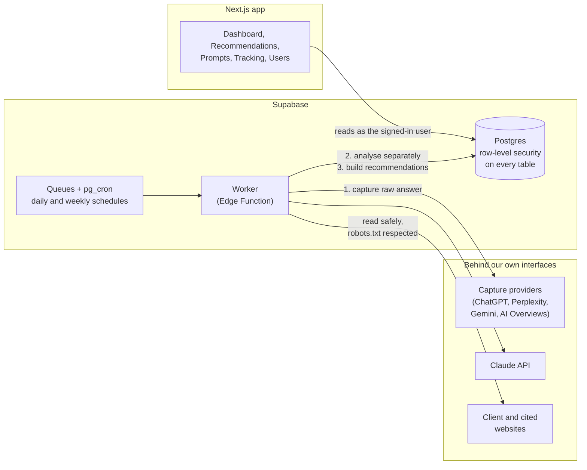

# Startify

**See how often AI assistants recommend your brand, and what to do to get recommended more.**

Startify is a GEO (Generative Engine Optimization) platform for B2B SaaS companies. It tracks how ChatGPT, Perplexity, Gemini, Google AI Overviews and Claude answer the questions buyers ask before they purchase, shows where competitors are recommended instead, and turns that data into concrete actions.

I designed and built it end-to-end as founder and product manager, building with Claude Code. The source code is private. This repository shows the product, the architecture and the key decisions.

---

## The problem

Buyers increasingly ask AI assistants "what's the best tool for X?" instead of searching Google. In interviews, B2B SaaS founders and growth teams told me:

1. GEO isn't on their priority list, and they can't see the revenue they're losing.
2. They have no time for it.
3. They don't know how it works.
4. They write blog posts with AI, but without research.
5. They can't calculate ROI.
6. Attribution from AI assistants is very hard.

So Startify does the thinking for them: plain language, a short list of clear actions, and research built into everything it hands over.

## What it does

**1. Tracks AI answers daily.** Each workspace (one per client) has its brand, competitors and buyer prompts. Every day, Startify asks each prompt to each AI model, stores the full answer, and records whether the brand is mentioned, its position, which competitors appear, and which sources are cited.

**2. Shows where you stand.** A dashboard with visibility over time per model, share of voice against competitors, average position, top cited sources, and whether pages you've published start getting cited.

**3. Recommends what to do.** Five kinds of recommendations, each with its evidence, an impact level and a status:

| Recommendation | What it does |
|---|---|
| **Fix your website** | Rule-based checks: AI crawlers blocked, content hidden behind JavaScript, missing structured data, llms.txt and more |
| **Get mentioned on** | Third-party sites that AI cites when it recommends competitors but not you, with the right action per site type |
| **Writing briefs** | Ready-to-paste prompts for any AI tool, with the research included: what cited pages cover, verified product facts, a structure AI engines cite, and a list of claims to check |
| **Wrong claims** | Statements in AI answers that contradict the client's facts, with where to correct them |
| **Improve a page** | Compares a competitor's cited page with the client's closest page and lists specific changes |

**4. Drafts the setup.** It reads the client's website to draft the facts sheet, suggests buyer prompts balanced across buying stages, and suggests competitors from what AI answers name. Nothing is saved until a person reviews it.

**5. Built for an agency and its clients.** Agency admins, agency members and read-only client viewers, with invite links and per-workspace roles.

## Screenshots

| | |
|---|---|
|  |  |
| **Dashboard (light):** visibility, share of voice, sources | **Recommendations:** one list for all five kinds |
|  |  |
| **Writing brief:** a ready-to-paste prompt with research | **Improve a page:** side-by-side comparison with a competitor |
|  |  |
| **Chat:** brands named and sources cited | **Prompts:** with AI-drafted suggestions |

*Screenshots use a fictional demo brand ("Tallyvane") with generated sample data.*

## Architecture

**How a tracking run works:** a schedule queues one job per prompt and model. The worker captures the raw answer first and analyses it in a separate step, so analysis can be improved and re-run without paying for the answers again. Every AI call is logged with its real cost per workspace.

## Key decisions

- **Workspace isolation enforced in the database, not only the app.** Every client table has row-level security, and every feature ships with a test proving a user in workspace A can't read or change workspace B.
- **Raw answers first, analysis second.** Retries never pay for a capture twice, and old answers can be re-analysed when the logic improves.
- **AI suggests, code verifies.** Wrong claims must quote text that really appears in the answer and a fact that really exists in the facts sheet. Suggested competitors must actually appear in the answers. The model can't invent either.
- **Untrusted web content is treated as data.** Research inside writing briefs is marked as background only. Pages are read only from allowed domains, with size and redirect limits.
- **Providers behind interfaces.** Capture services and models can be swapped without touching the rest of the product. A fake provider made the full pipeline buildable and testable at zero cost.
- **Performance found and fixed.** At realistic data volumes, security policies checked access once per row and dashboard queries timed out. Switching to a per-query workspace list brought them from timeouts to under 2.5 seconds, with no change in security.

## Tech stack

Next.js · TypeScript · shadcn/ui · Tremor (Recharts) · Tailwind · Supabase (Postgres, Auth, Queues, pg_cron, Edge Functions) · Anthropic SDK · Vitest

Open-source work I learned from and adapted, with credit: [Elmo](https://github.com/elmohq/elmo) (MIT) for mention matching and the capture pipeline pattern, and [GEO Optimizer](https://github.com/auriti-labs/geo-optimizer-skill) (MIT) for website checks.

## Quality

- 580+ automated tests, including isolation tests for every table and role
- Every feature planned, reviewed and built one small pull request at a time
- Each change checked in the browser in both themes, with a clean console

## Status

Version 1 is complete as an internal tool for a GEO agency, running on sample data. Next: switching on the real capture providers and models, and a self-serve version.

---

**Achintya** · Founder & product manager · [LinkedIn](#)
